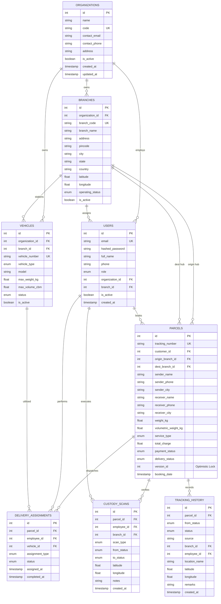

# LogiFlows — Database Schema & Architecture Reference

This document provides the authoritative database schema definition, entity relationships, integrity constraints, and migration history for the **LogiFlows Courier Management System**.

---

## 1. Entity-Relationship Diagram

---

## 2. Table Specifications & Constraints

### 1. `organizations`
Primary multi-tenant isolation unit.
- `id` (SERIAL PRIMARY KEY)
- `name` (VARCHAR(150), NOT NULL)
- `code` (VARCHAR(50), UNIQUE, NOT NULL, indexed)
- `contact_email` (VARCHAR(150))
- `contact_phone` (VARCHAR(30))
- `address` (TEXT)
- `is_active` (BOOLEAN, DEFAULT true)

### 2. `branches`
Physical sorting and distribution centers.
- `id` (SERIAL PRIMARY KEY)
- `organization_id` (INTEGER, FK $\rightarrow$ `organizations.id`, ON DELETE CASCADE)
- `branch_code` (VARCHAR(30), UNIQUE, NOT NULL, indexed)
- `branch_name` (VARCHAR(150), NOT NULL)
- `pincode` (VARCHAR(20), NOT NULL)
- `city` (VARCHAR(100), NOT NULL)
- `state` (VARCHAR(100), NOT NULL)
- `latitude` (FLOAT, NOT NULL)
- `longitude` (FLOAT, NOT NULL)
- `operating_status` (ENUM: `ACTIVE`, `INACTIVE`, `UNDER_MAINTENANCE`)

### 3. `users`
Authenticated actors and personnel.
- `id` (SERIAL PRIMARY KEY)
- `email` (VARCHAR(150), UNIQUE, NOT NULL, indexed)
- `hashed_password` (VARCHAR(255), NOT NULL)
- `full_name` (VARCHAR(150), NOT NULL)
- `role` (ENUM: `SUPER_ADMIN`, `ORG_ADMIN`, `BRANCH_MANAGER`, `DELIVERY_AGENT`, `CUSTOMER`)
- `organization_id` (INTEGER, FK $\rightarrow$ `organizations.id`, NULL for SUPER_ADMIN / retail CUSTOMER)
- `branch_id` (INTEGER, FK $\rightarrow$ `branches.id`, NULL for non-branch staff)
- `is_active` (BOOLEAN, DEFAULT true)

### 4. `vehicles`
Fleet logistics inventory.
- `id` (SERIAL PRIMARY KEY)
- `organization_id` (INTEGER, FK $\rightarrow$ `organizations.id`)
- `branch_id` (INTEGER, FK $\rightarrow$ `branches.id`)
- `vehicle_number` (VARCHAR(50), UNIQUE, NOT NULL, indexed)
- `vehicle_type` (ENUM: `BIKE`, `VAN`, `TRUCK`)
- `max_weight_kg` (FLOAT, NOT NULL)
- `status` (ENUM: `AVAILABLE`, `ON_TRIP`, `MAINTENANCE`, `OUT_OF_SERVICE`)

### 5. `parcels`
Core shipment consignment entity with optimistic concurrency control.
- `id` (SERIAL PRIMARY KEY)
- `tracking_number` (VARCHAR(50), UNIQUE, NOT NULL, indexed)
- `customer_id` (INTEGER, FK $\rightarrow$ `users.id`)
- `origin_branch_id` (INTEGER, FK $\rightarrow$ `branches.id`)
- `dest_branch_id` (INTEGER, FK $\rightarrow$ `branches.id`)
- `sender_name`, `sender_phone`, `sender_address`, `sender_city`, `sender_state`, `sender_pincode`
- `receiver_name`, `receiver_phone`, `receiver_address`, `receiver_city`, `receiver_state`, `receiver_pincode`
- `weight_kg`, `length_cm`, `width_cm`, `height_cm`, `volumetric_weight_kg`
- `service_type` (ENUM: `STANDARD`, `EXPRESS`, `OVERNIGHT`, `SAME_DAY`)
- `base_charge`, `weight_charge`, `service_charge`, `tax_amount`, `total_charge`
- `payment_status` (ENUM: `PENDING`, `PAID`, `FAILED`, `REFUNDED`, `CANCELLED`)
- `delivery_status` (ENUM: `BOOKED`, `PICKED_UP`, `AT_ORIGIN_BRANCH`, `IN_TRANSIT`, `AT_DESTINATION_BRANCH`, `OUT_FOR_DELIVERY`, `DELIVERED`, `CANCELLED`, `RETURNED`)
- `version_id` (INTEGER, DEFAULT 1, NOT NULL — Optimistic locking token preventing lost updates)

### 6. `delivery_assignments`
Assignment dispatch dispatching agents and fleet vehicles.
- `id` (SERIAL PRIMARY KEY)
- `parcel_id` (INTEGER, FK $\rightarrow$ `parcels.id`)
- `employee_id` (INTEGER, FK $\rightarrow$ `users.id`)
- `vehicle_id` (INTEGER, FK $\rightarrow$ `vehicles.id`, NULL allowed)
- `assignment_type` (ENUM: `FIRST_MILE_PICKUP`, `LINEHAUL_TRANSFER`, `LAST_MILE`)
- `status` (ENUM: `ASSIGNED`, `ACCEPTED`, `IN_TRANSIT`, `COMPLETED`, `CANCELLED`, `FAILED`)
- **Integrity Index:** `uq_active_parcel_assignment`  
  Partial unique index: `CREATE UNIQUE INDEX uq_active_parcel_assignment ON delivery_assignments(parcel_id) WHERE status IN ('ASSIGNED', 'ACCEPTED', 'IN_TRANSIT')`. Prevents double-dispatching the same parcel concurrently.

### 7. `tracking_history`
Append-only immutable audit trail of consignment lifecycle milestones.
- `id` (SERIAL PRIMARY KEY)
- `parcel_id` (INTEGER, FK $\rightarrow$ `parcels.id`, indexed)
- `from_status` (ENUM `ParcelStatus`, NULL on initial booking)
- `status` (ENUM `ParcelStatus`, NOT NULL)
- `source` (VARCHAR(50), e.g. `BOOKING`, `QR_SCAN`, `API`, `DISPATCH`)
- `branch_id` (INTEGER, FK $\rightarrow$ `branches.id`, NULL allowed)
- `employee_id` (INTEGER, FK $\rightarrow$ `users.id`, NULL allowed)
- `location_name` (VARCHAR(200))
- `latitude` (FLOAT), `longitude` (FLOAT)
- `remarks` (TEXT)
- `created_at` (TIMESTAMP WITH TIME ZONE, DEFAULT utcnow)

### 8. `custody_scans`
Chain-of-custody physical barcode and QR code verification events.
- `id` (SERIAL PRIMARY KEY)
- `parcel_id` (INTEGER, FK $\rightarrow$ `parcels.id`, indexed)
- `employee_id` (INTEGER, FK $\rightarrow$ `users.id`)
- `branch_id` (INTEGER, FK $\rightarrow$ `branches.id`, NULL allowed)
- `scan_type` (ENUM: `PICKUP_VERIFICATION`, `ORIGIN_INWARD`, `HUB_OUTWARD`, `DEST_INWARD`, `OUT_FOR_DELIVERY`, `DELIVERY_CONFIRMATION`)
- `from_status` (ENUM `ParcelStatus`)
- `to_status` (ENUM `ParcelStatus`)
- `notes` (TEXT)
- `created_at` (TIMESTAMP WITH TIME ZONE, DEFAULT utcnow)

---

## 3. Migration History

| Revision ID | Description | Operations | Downgrade Support |
| :--- | :--- | :--- | :--- |
| `71e88bd3018e` | Initial Schema Creation | Creates `organizations`, `branches`, `users`, `customers`, `vehicles`, `parcels`, `delivery_assignments`, `tracking_history`, `custody_scans` with indexes and foreign keys. | Drops all 9 tables and enum types cleanly. |
| `b2c3d4e5f6a7` | State Machine, Concurrency & Partial Indexes | Adds `version_id` column to `parcels`, adds `cancellation_reason`, `failed_attempts`, `pod_signature_url`, `pod_photo_url`, adds partial unique index `uq_active_parcel_assignment`, and converts `from_status` to enum. | Reverts columns and drops partial index cleanly. |
