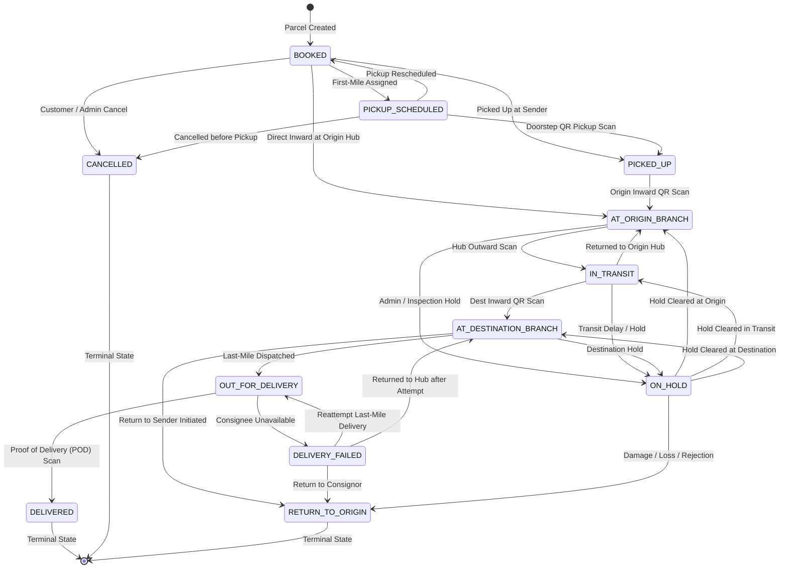

# LogiFlows Shipment State Machine & Concurrency Specification

This document defines the lifecycle, transition rules, concurrency guarantees, and QR custody security for shipments in the LogiFlows Courier Management System.

---

## 1. Shipment Lifecycle State Diagram



---

## 2. Comprehensive Transition Matrix

| From Status | To Status | Allowed Actor Roles | Preconditions & Validation | Side Effects & Actions | Terminal? |
|---|---|---|---|---|---|
| `BOOKED` | `CANCELLED` | Customer (owner), Branch Manager, Org Admin, Super Admin | Status must be `BOOKED`; Customer must own the parcel. | Sets `payment_status = REFUNDED`, records cancellation reason, appends tracking event. | **Yes** |
| `BOOKED` | `PICKUP_SCHEDULED` | Branch Manager, Org Admin, Super Admin | Branch must belong to caller's organization. | Updates parcel location, appends tracking event. | No |
| `BOOKED` | `PICKED_UP` | Delivery Agent, Branch Manager, Org Admin, Super Admin | Agent or staff within organization. | Appends tracking event with QR scan audit. | No |
| `BOOKED` | `AT_ORIGIN_BRANCH` | Delivery Agent, Branch Manager, Org Admin, Super Admin | Direct drop-off or inward scan at origin. | Updates `current_location`, appends tracking event. | No |
| `PICKUP_SCHEDULED` | `PICKED_UP` | Delivery Agent, Branch Manager, Org Admin, Super Admin | Doorstep pickup confirmed via QR scan. | Sets location to origin hub, appends tracking event. | No |
| `PICKUP_SCHEDULED` | `CANCELLED` | Customer (owner), Branch Manager, Org Admin, Super Admin | Same as BOOKED cancellation. | Sets `payment_status = REFUNDED`. | **Yes** |
| `PICKUP_SCHEDULED` | `BOOKED` | Branch Manager, Org Admin, Super Admin | Pickup attempt deferred. | Resets assignment, appends tracking event. | No |
| `PICKED_UP` | `AT_ORIGIN_BRANCH` | Delivery Agent, Branch Manager, Org Admin, Super Admin | Arrival at origin hub. | Updates `current_location`, appends tracking event. | No |
| `AT_ORIGIN_BRANCH` | `IN_TRANSIT` | Branch Manager, Org Admin, Super Admin | Vehicle/manifest prepared. | Updates `current_location`, appends tracking event. | No |
| `AT_ORIGIN_BRANCH` | `ON_HOLD` | Branch Manager, Org Admin, Super Admin | Customs or documentation hold. | Records remarks, appends tracking event. | No |
| `IN_TRANSIT` | `AT_DESTINATION_BRANCH` | Branch Manager, Org Admin, Super Admin | Inward destination scan. | Updates `current_location`, appends tracking event. | No |
| `IN_TRANSIT` | `AT_ORIGIN_BRANCH` | Branch Manager, Org Admin, Super Admin | Rerouted back to origin hub. | Updates `current_location`, appends tracking event. | No |
| `IN_TRANSIT` | `ON_HOLD` | Branch Manager, Org Admin, Super Admin | Inspection hold during transit. | Records remarks, appends tracking event. | No |
| `AT_DESTINATION_BRANCH` | `OUT_FOR_DELIVERY` | Branch Manager, Org Admin, Super Admin | **Requires active DeliveryAssignment** (status `ASSIGNED` or `IN_PROGRESS`). | Updates `current_location`, appends tracking event. | No |
| `AT_DESTINATION_BRANCH` | `ON_HOLD` | Branch Manager, Org Admin, Super Admin | Consignee reschedule request. | Records remarks, appends tracking event. | No |
| `AT_DESTINATION_BRANCH` | `RETURN_TO_ORIGIN` | Branch Manager, Org Admin, Super Admin | Return order initiated. | Appends tracking event. | **Yes** |
| `OUT_FOR_DELIVERY` | `DELIVERED` | Delivery Agent, Branch Manager, Org Admin, Super Admin | Consignee confirmation / OTP / POD. | Sets `actual_delivery_date = now`, marks active assignment as `COMPLETED`, releases vehicle. | **Yes** |
| `OUT_FOR_DELIVERY` | `DELIVERY_FAILED` | Delivery Agent, Branch Manager, Org Admin, Super Admin | Consignee absent or wrong address. | Records failure reason, appends tracking event. | No |
| `DELIVERY_FAILED` | `OUT_FOR_DELIVERY` | Branch Manager, Org Admin, Super Admin, Delivery Agent | **Requires active DeliveryAssignment**. | Increments attempt count, appends tracking event. | No |
| `DELIVERY_FAILED` | `AT_DESTINATION_BRANCH` | Delivery Agent, Branch Manager, Org Admin, Super Admin | Agent returns undelivered parcel to hub. | Updates `current_location`, appends tracking event. | No |
| `DELIVERY_FAILED` | `RETURN_TO_ORIGIN` | Branch Manager, Org Admin, Super Admin | Max attempts reached (3); return to sender. | Appends tracking event. | **Yes** |
| `ON_HOLD` | `AT_ORIGIN_BRANCH` | Branch Manager, Org Admin, Super Admin | Hold resolved at origin. | Updates `current_location`, appends tracking event. | No |
| `ON_HOLD` | `IN_TRANSIT` | Branch Manager, Org Admin, Super Admin | Hold resolved in transit. | Updates `current_location`, appends tracking event. | No |
| `ON_HOLD` | `AT_DESTINATION_BRANCH` | Branch Manager, Org Admin, Super Admin | Hold resolved at destination. | Updates `current_location`, appends tracking event. | No |
| `ON_HOLD` | `RETURN_TO_ORIGIN` | Branch Manager, Org Admin, Super Admin | Hold cannot be resolved; return initiated. | Appends tracking event. | **Yes** |

---

## 3. Terminal States & Invariants

1. **Terminal Definition:**
   `DELIVERED`, `CANCELLED`, and `RETURN_TO_ORIGIN` are strictly terminal. Any subsequent attempt to transition out of a terminal state is unconditionally rejected with `HTTP 400 Bad Request`.
2. **Immutable Tracking Audit Trail:**
   `tracking_history` is strictly append-only. There are no update or delete endpoints or methods.
3. **Atomicity Guarantee (AC6):**
   Every successful state transition updates `parcels` and creates exactly one `tracking_history` record within the same transaction. If an update fails (e.g. concurrency collision), rollback ensures zero tracking events are created.

---

## 4. Concurrency & Optimistic Locking

To guarantee that concurrent requests on the same shipment cannot corrupt state:
- `parcels` table includes an integer `version_id` column (default `1`).
- Status updates execute an atomic conditional SQL query:
  ```sql
  UPDATE parcels
  SET delivery_status = :to_status,
      version_id = version_id + 1,
      updated_at = :now
  WHERE id = :parcel_id
    AND version_id = :expected_version
    AND delivery_status = :from_status;
  ```
- If another concurrent transaction commits first:
  `rowcount == 0` causes an immediate rollback and raises `HTTP 409 Conflict`.
- Parametric multi-threaded tests verify that $N$ simultaneous conflicting requests produce exactly 1 success and $N-1$ HTTP 409 errors.

---

## 5. Cryptographic QR Custody Specification

1. **Unguessable Signed Payload:**
   Format:
   `LFQR.<tracking_number>.<issued_at>.<expires_at>.<nonce>.<signature>`
   - `issued_at`: Unix timestamp of token issuance.
   - `expires_at`: Unix timestamp of expiration (default 30 days).
   - `nonce`: Cryptographically secure 16-character hex string (`secrets.token_hex(8)`).
   - `signature`: First 32 characters of HMAC-SHA256(`SECRET_KEY`, `tracking_number:issued_at:expires_at:nonce`).
2. **Verification & Audit:**
   - Signature tampering, expiration, malformed structure, or cross-tenant access are caught and rejected immediately.
   - All scan attempts (both accepted and rejected) are permanently recorded in `custody_scans` with `is_successful` boolean and `failure_reason` for complete chain-of-custody compliance.

